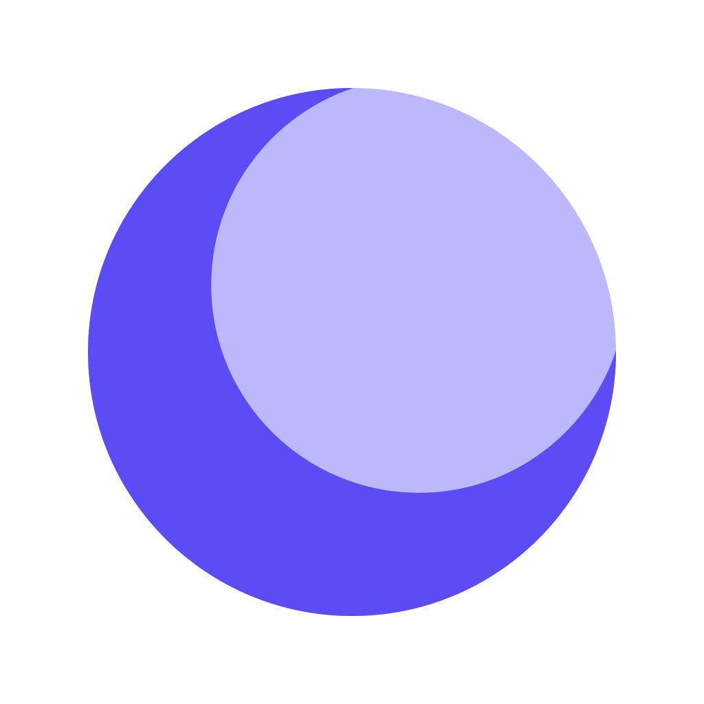

<p align="center">
  
</p>

<h1 align="center">Ombra</h1>

<p align="center">
  <strong>Don't trust others? Trust Ombra.</strong><br>
  Ombra is a vector database that keeps your vectors, queries, filters and scores encrypted, even while the server searches them.
</p>

<p align="center">
  <a href="https://github.com/erailabs/ombra/actions/workflows/ci.yml"></a>
  <a href="https://github.com/erailabs/ombra/actions/workflows/docs.yml"></a>
  <a href="https://erailabs.github.io/ombra/"></a>
  
  
  <a href="#license"></a>
</p>

<p align="center">
  <a href="https://erailabs.github.io/ombra/">Documentation</a> ·
  <a href="docs/site/getting-started/install.md">Quickstart</a> ·
  <a href="docs/site/security/what-the-server-learns.md">What the server learns</a> ·
  <a href="docs/site/roadmap.md">Roadmap</a>
</p>

---

## Why Ombra

When you put embeddings in a vector database, you hand them to whoever runs it. That might be a cloud provider, a vendor, or a team down the hall. They can read your vectors, and vectors give away more than people expect: you can often rebuild a good part of the original text from them. They can also read every query, which tells them what you are looking for.

Encryption that lets a server compute on data it cannot read, called fully homomorphic encryption (FHE), has existed for years. Until now, FHE vector databases gave you privacy but were so slow that the trade was rarely worth it. With Ombra we set out to remove that trade. We run the encrypted search on GPUs, pack many vectors into each ciphertext, and keep the work per query small, so you get both privacy and speed.

Your data is encrypted on your machine before it goes anywhere, and the secret key never leaves the Python client. The server stores the ciphertexts, runs the search on them, and sends back encrypted scores that only you can open.

Note that accuracy is not affected. Your client decrypts the scores and re-ranks the best candidates itself, so the top results are the real top results. The cryptography is CKKS through [OpenFHE](https://github.com/openfheorg/openfhe-development) 1.6.1, every preset is at least 128-bit secure, and every GPU kernel is checked against OpenFHE's own output.

Your data is now almost completely private, but not entirely. A curious server operator, or someone listening on the network, can still learn a few things about it, such as how many vectors you store and when you search. The section [below](#what-the-server-can-still-see) lists all of them.

## Try it in two minutes

You do not need a GPU to try it. Local mode runs a CPU server inside your Python process:

```bash
pip install "ombra-db[local]" sentence-transformers
python examples/local_search.py
```

Local mode is slow (a few seconds per search) and meant for trying Ombra and for small collections. Wheels exist for Python 3.11 to 3.13 on Linux (x86_64, aarch64) and macOS 15 or newer (arm64, x86_64). There is no Windows build yet.

When you want GPU speed, start the server with `docker compose up -d` on a host with a [supported NVIDIA GPU](docs/site/operations/gpus.md), and point the client at it with `Client("host:port", ...)`.

## What you get

- Encrypted vectors, queries, filters and scores, end to end
- Equality and integer range filters, evaluated on ciphertexts
- Collections with aliases, and `ombra-migrate` to rebuild a collection or rotate its keys
- Several server nodes behind a router that never decrypts anything (first phase)
- API keys with read, write and admin scopes, optionally limited to one collection
- A REST admin API, structured logs with request ids, online backups and a storage checker
- LangChain and LlamaIndex adapters

Ombra has no published release yet. The [roadmap](docs/site/roadmap.md) lists what is still missing.

## What the server can still see

We would rather you hear this from us. Ombra assumes an honest-but-curious server: it runs the software correctly but tries to learn what it can. A server that cheats can return wrong results, and the client cannot tell.

Even an honest one sees some things: how many vectors you store, the ids you choose (so use random ones), which cluster each vector is in, how many queries you send and when, and, after each search, which records your client fetches. The Decoy and Strict privacy levels hide which clusters a query asks for, but not the rest.

The full list is in [What the server learns](docs/site/security/what-the-server-learns.md). No outside cryptographer has reviewed Ombra yet, so treat the cryptography as unreviewed until one has. To report a vulnerability, see [SECURITY.md](SECURITY.md).

## How it was built

Most of Ombra's code was written by AI coding agents (Claude Code), working from plans, design decisions and acceptance tests written by a human maintainer. The maintainer decides what gets built, makes every design and security decision, and reviews changes before they merge.

The agents work under fixed rules: no parameters below 128-bit security, the secret key never leaves the client, no plaintext in logs, a test against OpenFHE for every GPU kernel, and a version header on every file format. CI runs the CPU, OpenFHE, sanitizer and fuzzing jobs on every pull request. The rules the agents follow are public, in [CLAUDE.md](CLAUDE.md) and `.claude/`.

We say this so you can weigh it. AI-written code can be wrong in ways that look right, and in cryptography that matters more than usual. It is one more reason to wait for the outside review before you trust Ombra with data that matters.

## Documentation

- [Getting started](docs/site/getting-started/install.md): install, quickstart, your first search, local mode or a server, examples
- [Concepts](docs/site/concepts/homomorphic-encryption.md): what FHE and CKKS are, and who holds which key
- [How it works](docs/site/how-it-works/encoding.md): encoding, query expansion, search, clusters, filters, deletes
- [Security](docs/site/security/threat-model.md): the threat model and what the server learns
- [Operations](docs/site/operations/docker.md): running the server, routing, backups, migration, monitoring
- [Performance](docs/site/performance/latency-and-throughput.md): latency, throughput and storage

The `examples/` folder has runnable scripts. The adapters live in `integrations/langchain-ombra/` and `integrations/llama-index-vector-stores-ombra/`.

## Repository layout

| Folder | What lives there |
| --- | --- |
| `core/` | CUDA kernels and OpenFHE ciphertext format handling (C++/CUDA) |
| `server/` | gRPC and REST API, storage, router, GPU scheduling (C++) |
| `client/` | Python client: keys, encryption, top-k, re-ranking |
| `integrations/` | LangChain and LlamaIndex adapters |
| `examples/` | Runnable scripts |
| `tests/` | Cross-component and end-to-end tests |
| `docs/site/` | The documentation site |

## Development

GPU work runs on [Modal](https://modal.com). Our reference cards are NVIDIA Ampere: an A10 for development and an A100 for benchmarks. Turing, Ada and Hopper cards are built and tested too. See [CONTRIBUTING.md](CONTRIBUTING.md) before you open a pull request.

```bash
make help        # list all commands
make test        # CPU tests
make test-gpu    # GPU tests on Modal
make bench       # benchmarks on Modal (A100)
```

## License

Ombra is source-available and dual-licensed. You may use it under either:

1. the [PolyForm Noncommercial License 1.0.0](LICENSE), free for noncommercial use, or
2. a commercial license, required for any business use, including internal use inside a company. Contact: emanuele.romito@erailabs.com

You only need one of them. Source files carry the SPDX identifier `PolyForm-Noncommercial-1.0.0 OR LicenseRef-Ombra-Commercial`. The full legal text in [LICENSE](LICENSE) is what counts; this section is a summary.

| Who | Free? | What you need |
| --- | --- | --- |
| Individuals, hobbyists, students | Yes | Nothing |
| Universities and research institutes | Yes | Nothing |
| Charities, public bodies, non-commercial organizations | Yes | Nothing |
| Companies evaluating Ombra before buying | Yes, for a limited trial | A free evaluation license |
| Any company using Ombra for business, including internally for its own AI, products or services | No | A paid commercial license |

**What counts as commercial:** any use aimed at commercial advantage or private monetary compensation. For example, running Ombra in a product or service you sell, or inside a company for its own business operations. Personal use, research, education and use by charities and public bodies are noncommercial.

**Contributions:** outside contributors sign a Contributor License Agreement (CLA) before their first pull request is merged, so their code can be included in commercial licenses.
