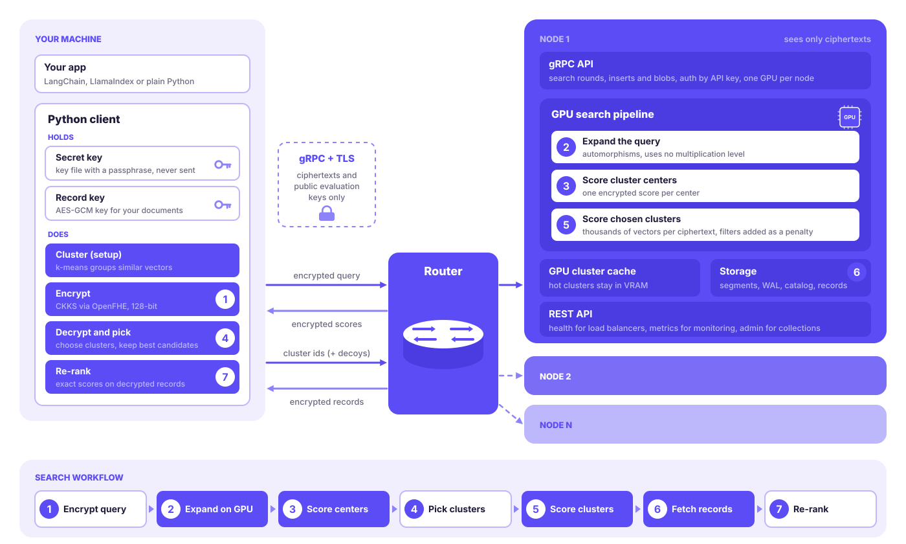

<p align="center">
  
</p>

<h1 align="center">Ombra</h1>

<p align="center">
  <strong>Don't trust others? Trust Ombra.</strong><br>
  Ombra is a vector database that keeps your vectors, queries, filters and scores encrypted, even while the server searches them.
</p>

<p align="center">
  <a href="https://github.com/erailabs/ombra/actions/workflows/ci.yml"></a>
  <a href="https://github.com/erailabs/ombra/actions/workflows/docs.yml"></a>
  <a href="https://erailabs.github.io/ombra/"></a>
  
  
  <a href="#license"></a>
</p>

<p align="center">
  <a href="https://erailabs.github.io/ombra/">Documentation</a> ·
  <a href="https://erailabs.github.io/ombra/getting-started/quickstart/">Quickstart</a> ·
  <a href="https://erailabs.github.io/ombra/how-it-works/encoding/">How it works</a> ·
  <a href="https://erailabs.github.io/ombra/security/threat-model/">Security</a> ·
  <a href="https://erailabs.github.io/ombra/roadmap/">Roadmap</a> ·
  <a href="CHANGELOG.md">Changelog</a>
</p>

---

## Why Ombra

When you put embeddings in a vector database, you hand them to whoever runs it. That might be a cloud provider, a vendor, or a team down the hall. They can read your vectors, and vectors give away more than people expect: you can often rebuild a good part of the original text from them. They can also read every query, which tells them what you are looking for.

Encryption that lets a server compute on data it cannot read, called fully homomorphic encryption (FHE), has existed for years. Until now, FHE vector databases gave you privacy but were so slow that the trade was rarely worth it. With Ombra we set out to remove that trade. We run the encrypted search on GPUs, pack many vectors into each ciphertext, and keep the work per query small, so you get both privacy and speed.

Your data is encrypted on your machine before it goes anywhere, and the secret key never leaves the Python client. The server stores the ciphertexts, runs the search on them, and sends back encrypted scores that only you can open.

Note that encryption does not cost you accuracy. Your client decrypts the scores and re-ranks the best candidates itself, so the top results are the real top results. The cryptography is CKKS through [OpenFHE](https://github.com/openfheorg/openfhe-development) 1.6.1, every preset is at least 128-bit secure, and every GPU kernel is checked against OpenFHE's own output.

Your data is now almost completely private, but not entirely. A curious server operator, or someone listening on the network, can still learn a few things about it, such as how many vectors you store and when you search. [What the server learns](https://erailabs.github.io/ombra/security/what-the-server-learns/) lists all of them.

## How it works

<p align="center">
  
</p>

At setup, your client groups similar vectors into clusters, so a search can skip most of the data. It encrypts the vectors, the cluster centers and a copy of each record, and uploads them with public evaluation keys, which let the server compute but not decrypt. Then every search goes like this:

1. **Encrypt the query.** The client encrypts it as one ciphertext and sends it.
2. **Expand it on the GPU.** The server turns that one ciphertext into the form the search needs, without decrypting anything.
3. **Score the cluster centers.** The server scores the query against every encrypted center and returns encrypted scores.
4. **Pick clusters.** Only the client can read those scores, so only it knows which clusters are closest. With the Decoy and Strict levels it mixes in random clusters, so the server cannot tell which ones it really wanted.
5. **Score the clusters.** The server scores every vector in them, thousands per ciphertext at once. With several nodes, the router sends each cluster to the node that holds it.
6. **Fetch records.** The client decrypts the scores and fetches the encrypted records of the best candidates.
7. **Re-rank.** The client decrypts those records and re-ranks them exactly on your machine. Encryption therefore changes no result. Like any clustered index, the clusters can miss a few neighbours; the [accuracy page](https://erailabs.github.io/ombra/how-it-works/accuracy/) has the numbers.

[How it works](https://erailabs.github.io/ombra/how-it-works/encoding/) in the docs goes through each step.

## Quickstart

Local mode runs a CPU server inside your Python process, so you can try Ombra without a GPU:

```bash
pip install "ombra-db[local]" sentence-transformers
```

```python
from ombra import Client
from sentence_transformers import SentenceTransformer


def main() -> None:
    texts = ["The central bank raised its policy rate.", "Kittens love to chase yarn.",
             "A GPU runs thousands of threads.", "Interest rates rose again."]
    model = SentenceTransformer("sentence-transformers/all-MiniLM-L6-v2")
    vectors = model.encode(texts, normalize_embeddings=True).tolist()

    client = Client.local("./ombra-data")  # a CPU server in a child process
    client.create_collection(
        "notes", vectors,
        key_file="notes.key",  # holds your secret key: back it up, never share it
        passphrase="change this passphrase",
    )
    query = model.encode(["What did the central bank do?"], normalize_embeddings=True)[0].tolist()
    for hit in client.search("notes", query, k=2):
        print(f"{hit.score:.3f}  {hit.id}")
    client.close()


if __name__ == "__main__":  # needed: local mode starts a child process
    main()
```

Local mode takes a few seconds per search and suits trying Ombra and small collections. For GPU speed, run the server with `docker compose up -d` on a host with a [supported NVIDIA GPU](https://erailabs.github.io/ombra/operations/gpus/) and connect with `Client("host:port", ...)`. The [quickstart](https://erailabs.github.io/ombra/getting-started/quickstart/) has the full script, and `examples/` has more.

## AI Disclosure

Most of Ombra's code was written by AI coding agents (Claude Code). 

## Documentation

- [Getting started](https://erailabs.github.io/ombra/getting-started/install/): install, quickstart, your first search, local mode or a server, examples
- [Concepts](https://erailabs.github.io/ombra/concepts/homomorphic-encryption/): what FHE and CKKS are, and who holds which key
- [How it works](https://erailabs.github.io/ombra/how-it-works/encoding/): encoding, query expansion, search, clusters, filters, deletes
- [Security](https://erailabs.github.io/ombra/security/threat-model/): the threat model and what the server learns
- [Operations](https://erailabs.github.io/ombra/operations/docker/): running the server, routing, backups, migration, monitoring
- [Performance](https://erailabs.github.io/ombra/performance/latency-and-throughput/): latency, throughput and storage

The `examples/` folder has runnable scripts. The adapters live in `integrations/langchain-ombra/` and `integrations/llama-index-vector-stores-ombra/`.

## License

Ombra is source-available and dual-licensed. You may use it under either:

1. the [PolyForm Noncommercial License 1.0.0](LICENSE), free for noncommercial use, or
2. a commercial license, required for any business use, including internal use inside a company. Contact: emanuele.romito@erailabs.com

You only need one of them. Source files carry the SPDX identifier `PolyForm-Noncommercial-1.0.0 OR LicenseRef-Ombra-Commercial`. The full legal text in [LICENSE](LICENSE) is what counts; this section is a summary.

| Who | Free? | What you need |
| --- | --- | --- |
| Individuals, hobbyists, students | Yes | Nothing |
| Universities and research institutes | Yes | Nothing |
| Charities, public bodies, non-commercial organizations | Yes | Nothing |
| Companies evaluating Ombra before buying | Yes, for a limited trial | A free evaluation license |
| Any company using Ombra for business, including internally for its own AI, products or services | No | A paid commercial license |

**What counts as commercial:** any use aimed at commercial advantage or private monetary compensation. For example, running Ombra in a product or service you sell, or inside a company for its own business operations. Personal use, research, education and use by charities and public bodies are noncommercial.

**Contributions:** outside contributors sign a Contributor License Agreement (CLA) before their first pull request is merged, so their code can be included in commercial licenses.
