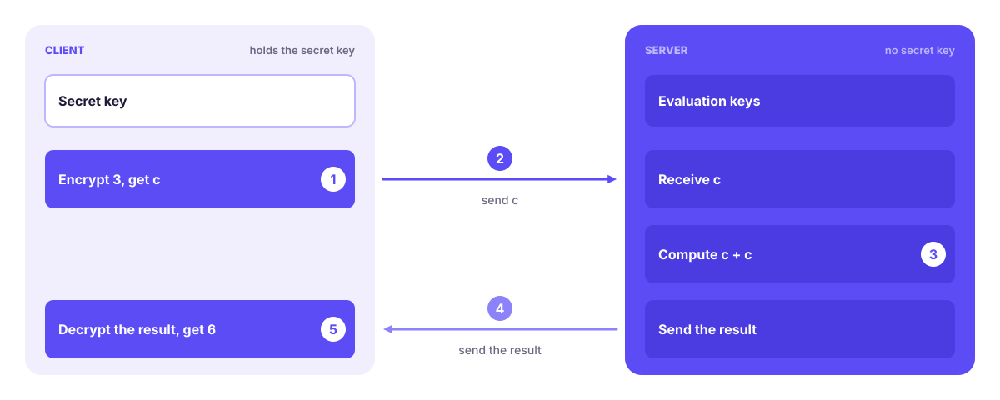

# Homomorphic encryption

Normal encryption protects data at rest and in transit. To compute on it, the server has to decrypt it first and then sees everything. Homomorphic encryption removes that step. The server computes on the ciphertext, and the result, once decrypted by the key holder, equals what the same computation on the plain data would have given.

Example: the client encrypts 3 into a ciphertext that looks like random bytes. The server adds the ciphertext to itself without learning what is inside. The client decrypts the result and gets 6.

## Terms used on the other pages

**Plaintext** is the data before encryption, **ciphertext** the encrypted form. **Encrypting** and **decrypting** need a key (see [Keys](keys.md)). **Evaluating** means computing on ciphertexts, and it is all the server does. A server can run additions and multiplications, and everything else is built from those. A dot product is multiplications followed by additions, so a server can score a query against stored vectors without seeing either.

## Why Ombra uses it

An embedding can be inverted to recover much of the text it came from. With homomorphic encryption the server stores and searches vectors, and receives your queries, without holding anything it can read. It is trusted only to run the computation, not with the data.

## What it costs, and what it cannot do

Computing on ciphertexts is expensive. With `balanced` ($N = {{ preset("balanced", "ring_dim") }}$) a fresh ciphertext is two polynomials of {{ preset("balanced", "ring_dim") }} coefficients over three 64-bit words each: 2 × 3 × 8 × 16384 bytes, about 0.8 MB. So Ombra runs the server on GPUs and packs thousands of values into each ciphertext (see [CKKS in simple terms](ckks.md)).

Limits that no setting removes:

- The server cannot compare. There is no `if` on an encrypted number. Ombra returns encrypted scores to the client, which decrypts them and picks the top results.
- Each multiplication uses part of a fixed budget, so a computation can only go a few multiplications deep. See the [CKKS page](ckks.md#levels-and-rescaling).
- Results are approximate: CKKS returns real numbers with a small error.

## Why HE and not FHE

A scheme is fully homomorphic when it can compute anything, for as long as needed. That needs an expensive refresh step called bootstrapping. Ombra does not bootstrap. It uses CKKS with a fixed depth of {{ preset("balanced", "multiplicative_depth") }} multiplications, enough for a dot product and a filter. A scheme with a fixed depth is called leveled, so Ombra uses homomorphic encryption (HE), not fully homomorphic encryption (FHE).
