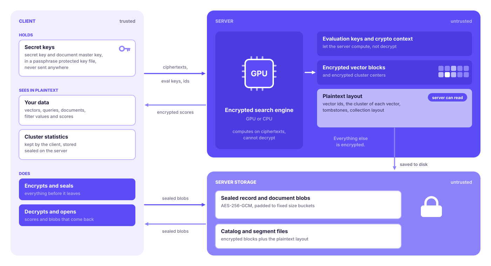

# Threat model

Ombra defends against an honest-but-curious server: one that runs the software correctly and answers every request, but tries to learn what it can from everything it stores and sees. That covers a hosting provider, an insider, and an attacker who has broken in and reads disk, memory and network traffic.

It does not defend against a server that lies. A malicious server can return wrong scores, drop results or serve old data, and the client cannot tell. See [Out of scope](out-of-scope.md).

## The parties

The **client** holds the secret key and every plaintext. It encrypts vectors and queries, decrypts the returned scores, picks the top k, and re-ranks the best candidates with exact vectors from the blob store (or, with private retrieval, from one encrypted call that does not show which records it fetched). Clustering also runs on the client. See [Keys](../concepts/keys.md).

The **server** holds only what the client sends: ciphertexts, the crypto context and evaluation keys, ids, and the layout of the collection. Its storage holds the encrypted blocks, the catalog, and the record and document blobs, which the client seals with AES-256-GCM into opaque bytes of a fixed size class. See [Documents](../how-it-works/documents.md).

## What we assume

- The secret key and key file stay on the client. No server message has a field for a secret key, and the server never logs one.
- OpenFHE is correct, and the [parameters](parameters.md) give at least 128-bit security.
- The network is hostile. The server refuses to start without TLS and API keys unless you pass `--insecure` or `--no-auth`, which only work on loopback addresses.
- The server is single-tenant. A key without a collection limit reads every collection and blob, and a write key can overwrite or delete data in any of them. Limited keys ([API keys](api-keys.md)) do not separate load or disk use. Run one server per trust domain.
- The client machine is not compromised. Whoever reads the key file and its passphrase reads everything.

We do not assume the server is physically secure, its operators trustworthy, or its disks and memory private. Everything it stores is a ciphertext, a sealed blob, or a plaintext item listed in [What the server learns](what-the-server-learns.md): notably ids, which you choose and which are stored in plaintext (never put sensitive data in one), and the cluster of each vector, named in the clear on insert.

## With a router

Behind `ombra_router`, the router and nodes are all untrusted in the same way. The router sees what one server sees, holds no HE key, and holds an API key for every node, so protect it like a server. Cluster placement depends only on the cluster number and node ids, so it tells a node nothing about the data and does not let it tell real clusters from decoys. Colluding nodes and router learn no more than one server. See [Several nodes and a router](../operations/routing.md#what-each-process-learns).

## Key rotation

`ombra-migrate --new-keys` replaces the keys of a collection (see [Rotating keys](../operations/migration.md#rotating-keys)): a new HE key pair and document master key, every vector encrypted again from its stored float32 copy, every blob sealed again. The old and new keys are unrelated, and the server gets no key that links them.

Rotation protects what you write and query after it, and the stored data once the old collection is dropped. It does not protect copies made before: a backup, disk image or copy of the stored blocks stays readable with the old key file. If the old key leaks, assume those copies are open. Destroy the old key file and delete the old copies as far as you control them.

## Search levels

Each collection has a search level, Fast, Decoy or Strict, and a query can override it. The level controls which clusters the server is asked to score, so how much the cluster choice reveals about a query. Data and query are encrypted in all three. After every search, at every level, the client fetches the record blobs of its best candidates by id, which shows the server which records were candidates and how large k is. A collection created with `private_retrieval=True` replaces that fetch with one encrypted call, which shows only the clusters in scope, the number of rows and the message sizes ([Private record retrieval](../how-it-works/private-retrieval.md)); its hits carry their metadata, and with `fetch_documents=True` their documents up to 256 KiB come back by the same kind of call; reading a record or document by id, or a larger document, still shows that id. See [Clusters and search levels](../how-it-works/clusters.md).

There is no plaintext-database mode. Every vector is stored encrypted.

!!! deep-dive "Why there is no formal guarantee for the cluster choices"
    In Fast and Decoy the client decrypts scores and then chooses which clusters to ask for next, so the server sees a function of decrypted values. CKKS decryption is approximate, and decrypted results can leak information about the secret key if shown to someone who also holds the ciphertext (the IND-CPA-D setting). Ombra never sends decrypted values to the server, only the cluster ids derived from them. We make no IND-CPA-D claim, and we have not analysed what the ranking of clusters reveals beyond the ids.
